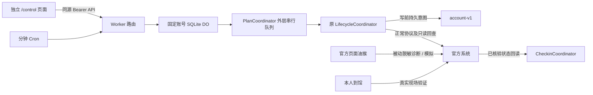

# 架构与事务边界

日期：2026-10-15。沿用 PR #1，接管远端 `8d85022`，不重置历史，不改 DO namespace、对象名称或 SQLite migration tag。

Worker 是当前生产自动预约唯一写入端。油猴没有安装远端提交协调器，拒绝 LIVE；离线测试注入合成协调器仅用于保留原适配器回归测试。无法安全地把长期 Worker 令牌放入官方页，因此配置页与官方页分离。需要停用旧版脚本，单个新版无法控制用户仍安装的独立旧代码。

## 数据结构与迁移

`ReservationPlan` 包含稳定 planId、递增 revision、生效日、房间、有序候选、EXACT/ORDERED/QUERY_ONLY、日期/星期/暂停日、多个模板、单日覆盖、现场签到模式和提醒开关。一个账号同时维护一个活动预约周期，计划支持循环与日期覆盖；不创建多账号、多日期并发抢占。

首次在原 `account-v1` 增量加入 `plans.schemaVersion=1`。旧部署参数转换为暂停/仅查询计划，不改原日志、监督标记、待提交授权或归档。保留初始配置用于恢复；保留相关活动日期与未来版本，历史过多且无法安全压缩时拒绝继续编辑。未知 journal/plan schema 需要人工复审，不自动降级或清空。

`ReservationAttempt`（兼容别名 Operation）保留原有操作键、授权来源、提交窗口、次数、退避、结果和 READY/SUBMITTED_UNVERIFIED/CONFIRMED/REJECTED。`ReservationEvidence` 与 `CheckinEvidence` 区分预约确认与签到确认；`CheckinAttempt` 独立于计划，保存学校状态的观测结果。提醒领取 ID 和候选 cursor 也是持久状态。

GET 配置初始化只写本地 DO 状态，不访问学校。PUT 使用完整白名单对象与 revision CAS，单次最多 16KiB，限制模板/候选/覆盖数量。计划版本、历史及审计在同一次 storage.put 中保存，失败不暴露半份新配置。配置编辑与所有网络生命周期共用外层队列，因此编辑不能穿过正在提交的请求。

已经尝试的日期、已知真实预约或 pendingRun 保留原目标；计划修改须选未来生效日。只读跟踪后尚未尝试且无已知预约时，可以修改本地目标，随后仍重新查询学校。全局暂停独立于计划，可随时阻止后续提交；不取消已发送请求、不清除未知意图。

## 提交与恢复

1. 选目标日有效版本和模板，校验日期、上海时区、房间证据、开放时间、时间网格、最短/最长时长。
2. 检查启用、暂停、写开关、状态映射；读取学校记录及明确资格。缺字段、未知码、其他预约、验证码、监督或黑名单阻止写入。
3. 准备官方页面签名后再次读取资格与记录，并重查预约开始时间。将 SUBMITTED_UNVERIFIED 持久化后才 POST。
4. 明确匹配预约记录才确认。HTTP/网络/JSON/响应不匹配保留不确定意图，仅做正向回读；空列表不证明失败。
5. 明确冲突只在校方已核验的 success=false + 精确 code 映射下推进候选 cursor；至少 60 秒后再尝试。未知、认证、风控和限流不推进。
6. 外层 DO 队列串行化 Cron、手工、两个控制页、配置编辑；原内层队列与持久日志负责写前意图和重启恢复。进程锁本身不替代存储。

自动预约使用现有分钟 Cron，按已核验规则扫描最多 31 个日期，开放后最多迟到 15 分钟。重复/延迟 Cron 不依赖固定 22:30，也不会在预约开始后补发。旧 14:29 UTC Cron 保留注册以支持回滚，新生产入口忽略它。机器时钟未与学校测量偏移，控制页明确显示校时边界，不承诺毫秒精度。

单次运行读取限频至少 60 秒，持续未知状态继续沿用生命周期指数退避。过期窗口事件和两阶段提醒均去重。缓存预约确认只说明提交曾成功，最新学校状态单独显示。

## 签到、取消与释放

目前没有本校允许无人值守签到的正式契约，`CheckinCoordinator` 没有签到写 transport，也没有接受“我已在场”的布尔参数。本人从域名与路径白名单入口完成官方现场流程，系统回读；只有匹配记录且来源为 VERIFIED_STATUS_PROFILE 的 SIGNED_IN 才有成功证据。未知响应、时间经过、重复按钮或重启都不能合成签到成功。旧缓存签到不会覆盖新的 UNKNOWN 观察或新一天预约。

默认 30/30 分钟仅为 advisory 提示窗口。取消/退座没有已验证 transport，保持人工路径。已有释放重约协调器保留，在显式释放、规则许可、预算与全部开关满足时才可从执行入口推进；普通监测和签到回读强制只读。未核验学校状态/资格时它仍不可用。

## 安全边界

控制页使用 nonce CSP、禁止 framing、无外部脚本、无 Cookie 认证、无 CORS 放行；管理令牌只在页面闭包中，刷新即清除，拒绝跨站 Origin/Sec-Fetch-Site、URL token、非 JSON 和未知字段。学校凭据及 enc 仅由 secrets 提供，学校请求禁止携凭据跟随重定向。

管理状态投影保留“ID 存在”摘要，移除完整预约 ID、原始状态文本及嵌套事件中的 ID。内部 DO 必须保存实际 ID 才能安全回读，因此 DO 存储属于私有账号状态，不能作为公开诊断导出。浏览器日志去除响应自由文本、URL query、UID 与秘密字段；用户触发的诊断仅导出独立白名单格式。

提醒先持久领取再交给浏览器，保证跨标签及重启不重复领取，但页面崩溃后可能漏送。浏览器关闭时不能发送浏览器通知，Worker 预约调度不依赖页面存活。没有引入新依赖、付费服务或消息队列。
